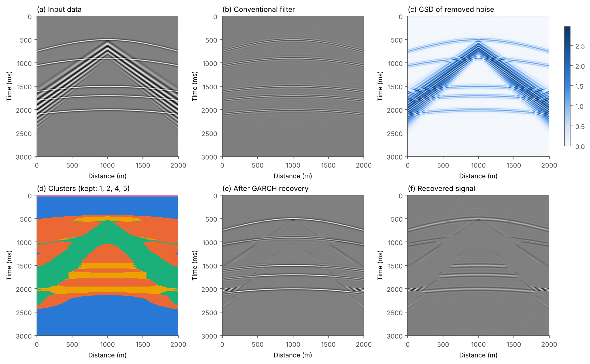
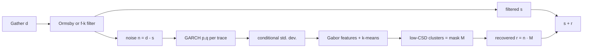
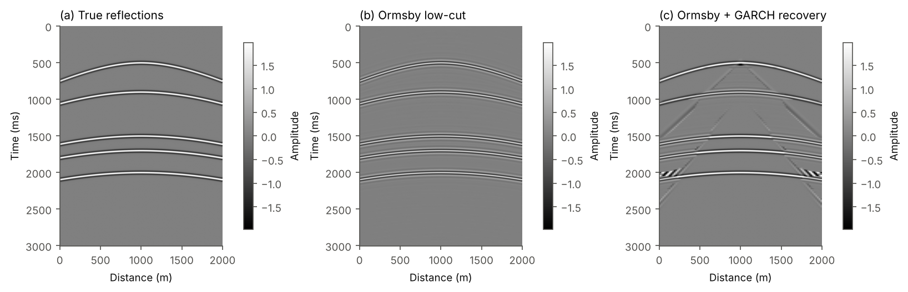
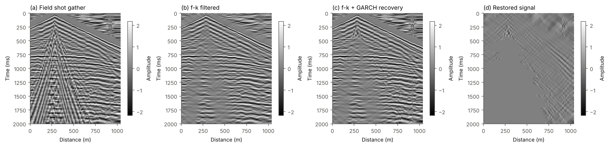

# GARCH ground-roll signal recovery

[](https://github.com/MohammadAmin-Aminian/garch-groundroll/actions/workflows/tests.yml)
[](LICENSE)
[](https://doi.org/10.1080/08123985.2022.2135430)

Python and MATLAB implementation of

> **Aminian, M. A. & Riahi, M. A. (2023).** Enhanced data fidelity after ground roll
> attenuation using conditional standard deviation clustering obtained from the GARCH
> model. *Exploration Geophysics*, 54(3), 271–287.
> [doi:10.1080/08123985.2022.2135430](https://doi.org/10.1080/08123985.2022.2135430)

Conventional ground-roll filters (Ormsby, f-k) also remove part of the reflection
energy. This method models the removed noise with a **GARCH** process, clusters its
**conditional standard deviation (CSD)** and puts the low-CSD part, i.e. leaked
reflections, back into the filtered data.



---

## Contents

- [How it works](#how-it-works)
- [Results](#results)
- [Python](#python)
- [MATLAB](#matlab)
- [Configuration](#configuration)
- [Repository layout](#repository-layout)
- [Validation](#validation)
- [Changes with respect to the original scripts](#changes-with-respect-to-the-original-scripts)
- [Limitations](#limitations)
- [Citation](#citation)

## How it works



1. **Filter**: attenuate ground roll with an Ormsby low-cut or an f-k filter; the removed
   part is the noise `n`.
2. **GARCH**: fit a zero-mean GARCH(p, q) model to every noise trace by maximum likelihood
   and compute the conditional standard deviation σₜ.
3. **Cluster**: segment the CSD image with Gabor texture features and k-means.
4. **Select**: ground roll has a large CSD and leaked reflections a small one, so the
   clusters below the largest jump in mean CSD are classified as signal.
5. **Recover**: `corrected = filtered + noise · mask`.

The equations and implementation choices are in [docs/method.md](docs/method.md).

## Results

All numbers come from `python examples/reproduce_paper.py` and are stored in
[docs/results.json](docs/results.json).

| Dataset | Paper figs | Filter | GARCH | SNR filtered | SNR after recovery | Gain | Original study |
|---|---|---|---|---:|---:|---:|---|
| Synthetic (truth known) | 2 | Ormsby 0–15/25 Hz | (1,1) | −7.40 dB | −4.31 dB | **+3.08 dB** | — |
| ↳ *true SNR vs. clean reflections* | | | | 4.40 dB | 6.59 dB | **+2.19 dB** | — |
| Shot gather, 502 traces | 3–12 | f-k (paper mask) | (1,1) | −1.58 dB | −1.37 dB | **+0.22 dB** | −1.58 → −1.43 dB (+0.15) |
| Field shot gather | 13–16 | f-k (paper mask) | (1,1) | +3.47 dB | +4.22 dB | **+0.74 dB** | qualitative |
| Stacked section | 17–18 | Ormsby 0–5/7.5 Hz | (2,2) | +0.93 dB | +1.11 dB | **+0.18 dB** | ratio 1.08 ("8 %") |
| 3-D cross-line | 19–20 | f-k fan | (1,1) | +2.67 dB | +2.73 dB | **+0.06 dB** | ratio 1.21 ("21 %") |

SNR = 10·log₁₀(Σ filtered² / Σ removed noise²), before and after the recovery, as in the
paper. The paper quoted the ratio of the two dB values; the gain in dB is reported here
(see [the note below](#changes-with-respect-to-the-original-scripts)). The stacked
section and cross-line use automatic, conservative cluster selection instead of the hand-drawn
masks of the original study, so their gains are smaller. On the 502-trace gather the
recovered result also has the highest mean local correlation with the input
(Ormsby 0.28, f-k 0.40, f-k + GARCH 0.44), as in paper Fig. 12. The trace-by-trace GARCH
order comparison (paper Fig. 5) favours the largest model by raw log-likelihood, but by
BIC GARCH(3,1), GARCH(2,1) and GARCH(1,1) win on 48 %, 36 % and 16 % of the traces.

<table>
<tr>
<td></td>
</tr>
<tr><td><em>Synthetic gather. The Ormsby low-cut weakens the reflections (b); GARCH recovery restores most of their amplitude (c).</em></td></tr>
<tr>
<td></td>
</tr>
<tr><td><em>Field shot gather: input, f-k filter, f-k + GARCH recovery and the restored signal (paper Figs. 13–16).</em></td></tr>
</table>

<details>
<summary><b>All figures</b> (paper figure numbers in brackets)</summary>

| Figure | Content |
|---|---|
| [fig01](docs/figures/fig01_synthetic_workflow.png) | Workflow on the synthetic gather [2] |
| [fig02](docs/figures/fig02_synthetic_vs_truth.png) | Synthetic: truth vs. Ormsby vs. GARCH |
| [fig03](docs/figures/fig03_shot_data_fk.png) | Shot gather, f-k filtered data and removed noise [3, 4] |
| [fig04](docs/figures/fig04_shot_garch_orders.png) | Log-likelihood of 9 GARCH(p,q) models per trace [5] |
| [fig05](docs/figures/fig05_shot_csd.png) | Conditional variance and conditional standard deviation [6] |
| [fig06](docs/figures/fig06_shot_clusters.png) | Noise, clusters and restored-signal mask [7] |
| [fig07](docs/figures/fig07_shot_noise_vs_garch.png) | f-k noise, GARCH noise and their difference [8] |
| [fig08](docs/figures/fig08_shot_fk_spectra.png) | f-k spectra [9] |
| [fig09](docs/figures/fig09_shot_trace148.png) | Trace 148 through the processing stages [10] |
| [fig10](docs/figures/fig10_shot_spectra.png) | Amplitude spectra [11] |
| [fig11](docs/figures/fig11_shot_local_correlation.png) | Local correlation with the input [12] |
| [fig12](docs/figures/fig12_field_shot.png) | Field shot gather [13] |
| [fig13](docs/figures/fig13_field_clusters.png) | Field shot clusters |
| [fig14](docs/figures/fig14_field_spectra.png) | Field shot spectra [14, 15] |
| [fig15](docs/figures/fig15_field_fk.png) | Field shot f-k spectra [16] |
| [fig16](docs/figures/fig16_section_ormsby.png) | Stacked section and Ormsby filter [17] |
| [fig17](docs/figures/fig17_section_garch.png) | Stacked section after GARCH recovery [18] |
| [fig18](docs/figures/fig18_crossline.png) | 3-D cross-line [19, 20] |

</details>

## Python

**Requirements:** Python ≥ 3.9 with NumPy, SciPy, scikit-learn and Matplotlib.

```bash
git clone https://github.com/MohammadAmin-Aminian/garch-groundroll.git
cd garch-groundroll
python -m pip install -e .          # or: pip install -r requirements.txt
```

### Quick start

```bash
python examples/quickstart.py
```

```python
from garch_groundroll import load_config, make_synthetic_shot, run_pipeline, true_snr_db

g = make_synthetic_shot()                                   # reflections + ground roll
res = run_pipeline(g.data, g.dt, g.dx, load_config("synthetic"))
print(res.summary())
print(true_snr_db(res.filtered, g.signal), "->", true_snr_db(res.corrected, g.signal), "dB")
```

### Reproduce the paper

```bash
python examples/reproduce_paper.py --jobs -1          # all experiments, all CPU cores
python examples/reproduce_paper.py --fast             # skip the 9-model GARCH comparison
python examples/reproduce_paper.py --only field_shot  # one experiment
```

This writes the figures to `docs/figures/` and the numbers to `docs/results.json`.
The full run takes about 20 min on one core; `--fast --jobs -1` takes about 3 min.

### Command line

```bash
garch-groundroll datasets                                   # list bundled data
garch-groundroll run --config field_shot --jobs -1          # one dataset, paper settings
garch-groundroll run --input my_gather.mat --config my.json --out results/my_gather
garch-groundroll run --input my_gather.npy --dt 0.002 --dx 10 --config my.json
```

Each run writes `result.mat` (filtered, noise, CSD, labels, mask, corrected data …),
`summary.json`, `config_used.json` and four figures.

### Your own data

```python
import numpy as np
from garch_groundroll import agc, run_pipeline
from garch_groundroll.plotting import plot_workflow, save

d = agc(np.load("gather.npy"), window=100)           # (n_samples, n_traces)
res = run_pipeline(d, dt=0.002, dx=10.0, config={
    "filter": {"type": "fk_fan", "v_reject": 600, "v_pass": 900, "f_max": 20},
}, verbose=True)
save(plot_workflow(res, 0.002, 10.0), "workflow.png")
```

Any external filter can be used: `run_pipeline(d, dt, dx, cfg, filtered=my_filtered_gather)`.

### Tests

```bash
pip install -e ".[dev]"
pytest
```

## MATLAB

**Requirements:** MATLAB R2016b or newer. **No toolboxes are needed**: GARCH estimation,
Gabor filtering, k-means and all filters are implemented in base MATLAB.

```matlab
cd garch-groundroll/matlab
setup                        % adds matlab/src to the path
cd examples
quickstart                   % synthetic example
reproduce_paper              % all experiments -> garch-groundroll/results/matlab
cd ../tests
run_tests                    % unit tests
```

```matlab
ds  = ggr_load_dataset('field_shot');
cfg = ggr_load_config('field_shot');                 % same JSON as Python
res = ggr_run_pipeline(ds.data, ds.dt, ds.dx, cfg, 'FkMask', ds.fkMask);
ggr_print_summary(res);
ggr_plot_workflow(res, ds.dt, ds.dx, 'Field shot');
```

| Python | MATLAB |
|---|---|
| `run_pipeline` | `ggr_run_pipeline` |
| `fit_garch`, `fit_garch_traces`, `select_garch_order` | `ggr_garch_fit`, `ggr_garch_traces`, `ggr_select_garch_order` |
| `ormsby_filter`, `fk_fan_filter`, `fk_mask_filter` | `ggr_ormsby`, `ggr_fk_fan`, `ggr_fk_mask` |
| `build_features`, `kmeans`, `select_signal_clusters` | `ggr_build_features`, `ggr_kmeans`, `ggr_select_clusters` |
| `snr_report`, `local_correlation`, `true_snr_db` | `ggr_snr_report`, `ggr_local_correlation`, `ggr_true_snr_db` |
| `make_synthetic_shot`, `agc` | `ggr_make_synthetic`, `ggr_agc` |
| `load_dataset`, `load_config` | `ggr_load_dataset`, `ggr_load_config` |

The two implementations use the same model, parameterisation, features and
configuration files. Results agree up to the optimiser (L-BFGS-B vs. Nelder–Mead) and
the random initialisation of k-means.

## Configuration

Experiments are described by JSON files in [`configs/`](configs), read by both languages.

```jsonc
{
  "dataset": "field_shot",
  "filter":   {"type": "fk_mask"},            // or "ormsby" / "fk_fan", see below
  "garch":    {"p": 1, "q": 1},               // p GARCH terms, q ARCH terms
  "features": {
    "wavelengths":  [3, 6, 12, 24],           // Gabor wavelengths (pixels)
    "orientations": [0, 30, 60, 90, 120, 150],// degrees
    "smoothing": 1.5,                         // Gaussian sigma = smoothing * wavelength
    "scaling": "clip",                        // CSD -> [0,1]: clip | minmax | none
    "coordinates": true                       // add row/column as features
  },
  "clustering": {
    "n_clusters": 4, "n_init": 10, "seed": 0,
    "selection": "gap"                        // gap | n_keep | threshold | manual
    // "n_keep": 2, "threshold": 0.3, "clusters": [2, 3]
  }
}
```

| filter `type` | parameters |
|---|---|
| `ormsby` | `corners` `[f1, f2, f3, f4]` (Hz), `mode` `bandstop` (default) or `bandpass` |
| `fk_fan` | `v_reject`, `v_pass` (m/s), optional `f_max`, `f_taper` (Hz) |
| `fk_mask` | uses the `fk_mask` stored in the data file |

## Repository layout

```
├── src/garch_groundroll/   Python package
│   ├── garch.py            GARCH(p,q) maximum likelihood, order selection
│   ├── filters.py          Ormsby, f-k fan and mask filters, spectra
│   ├── features.py         Gabor texture features of the CSD
│   ├── clustering.py       k-means, cluster selection
│   ├── pipeline.py         end-to-end workflow
│   ├── metrics.py          SNR, local correlation
│   ├── synthetic.py        synthetic shot gather
│   ├── plotting.py         figures
│   ├── io.py               datasets and configurations
│   └── cli.py              command-line interface
├── matlab/
│   ├── src/                MATLAB toolbox (ggr_*.m), base MATLAB only
│   ├── examples/           quickstart.m, reproduce_paper.m
│   └── tests/run_tests.m
├── configs/                experiment settings (shared by Python and MATLAB)
├── data/                   gathers used in the paper (see data/README.md)
├── examples/               quickstart.py, reproduce_paper.py
├── docs/                   method.md, figures/, results.json
└── tests/                  pytest suite
```

## Validation

* **GARCH estimator vs. MATLAB Econometrics Toolbox.** The original study's saved output
  for the stacked section (GARCH(2,2), 281 traces, `estimate` + `infer`) was compared with
  this implementation on the same noise: median correlation of the conditional standard
  deviation **0.9999999999**, log-likelihood within 0.1 of MATLAB on 92 % of traces
  (median difference −0.006); on 62 % of the traces this implementation reaches an equal or
  higher likelihood, and the largest shortfall is 1.4 log-likelihood units.
* **Reproduction of the f-k step.** With the stored reject mask the f-k filtered shot gather
  matches the original result to 2·10⁻⁷, and the SNR of the f-k result (−1.583 dB)
  equals the original value.
* **Clustering.** On the 502-trace gather, the automatically selected mask agrees with
  the manually selected mask of the original study on 92 % of the samples.
* **Known truth.** On the synthetic gather the true SNR (against the clean reflections)
  rises from 4.40 dB after the Ormsby filter to 6.59 dB after GARCH recovery.
* **Unit tests** for the GARCH recursion and parameter recovery, filters, features,
  clustering and the full pipeline, in both languages, run on every push (GitHub Actions).

## Changes with respect to the original scripts

The research scripts behind the paper were interactive and are not included. This
repository is a clean re-implementation; the main corrections are:

1. **No hand-drawn masks.** `roipoly` (f-k reject zones and cluster masks) is replaced by
   the stored paper masks, parametric fan filters and automatic cluster selection.
2. **Cluster selection by CSD, not by label number.** The scripts kept hard-coded labels
   (`L2 == 2`), but k-means labels change between runs. Clusters are now ranked by
   mean CSD.
3. **SNR change in dB.** The scripts reported `S2/S1`, a ratio of decibel values. With
   negative SNR (e.g. −1.58 → −1.43 dB) that ratio is 0.90 although the SNR *improved*.
   The gain `S2 − S1` is now reported, with the ratio kept for comparison.
4. **Sampling of the stacked section.** The paper gives 4 ms, but the Ormsby filter was
   applied with 2 ms, which doubles every frequency. The band is now specified at the true
   sampling.
5. **Model-order selection with BIC.** Comparing raw log-likelihoods always favours the
   largest nested model.
6. **Missing third-party functions** (`ormsbybandpassfilter`, `local_correlation`,
   `fk_spectra`, `agc`) are re-implemented. The brick-wall FFT filter, whose frequency
   indices were not integers and which zeroed an asymmetric band, is replaced by the Ormsby
   filter.
7. **Robust k-means** (10 restarts) and a fixed seed make the clustering reproducible.
8. **No toolbox dependencies** in MATLAB (Econometrics, Image Processing, Statistics and
   Signal Processing Toolboxes were required before).

## Limitations

* The method assumes that ground roll has the **largest CSD**. Weak ground roll, such as the
  shallow scattered "chevrons" of the 3-D cross-line, can fall into a low-CSD cluster and be
  restored with the signal. Inspect `plot_clusters` and use `selection="n_keep"` or
  `"manual"` when needed. For this reason only one cluster is restored for the cross-line.
* With a filter that already preserves the reflections well (the f-k fan filter on the
  synthetic) there is little to recover, and restoring cluster edges can slightly lower the
  true SNR (15.88 → 14.74 dB). The method is most useful after aggressive
  low-cut filtering.
* The SNR used in the paper measures the energy ratio of filtered data to removed noise; it
  increases whenever energy is moved back from the noise and does not prove that the moved
  energy is signal. Use the synthetic and visual checks alongside it.
* GARCH fitting is per trace and dominates the run time (about 0.05–0.1 s per trace in
  Python; use `--jobs -1`).

## Citation

If you use this code, please cite the article (see also [CITATION.cff](CITATION.cff)):

```bibtex
@article{aminian2023garch,
  author  = {Aminian, Mohammad Amin and Riahi, Mohammad Ali},
  title   = {Enhanced data fidelity after ground roll attenuation using conditional
             standard deviation clustering obtained from the {GARCH} model},
  journal = {Exploration Geophysics},
  volume  = {54},
  number  = {3},
  pages   = {271--287},
  year    = {2023},
  doi     = {10.1080/08123985.2022.2135430}
}
```

## License

Code: [MIT](LICENSE). Data: see [data/README.md](data/README.md).
